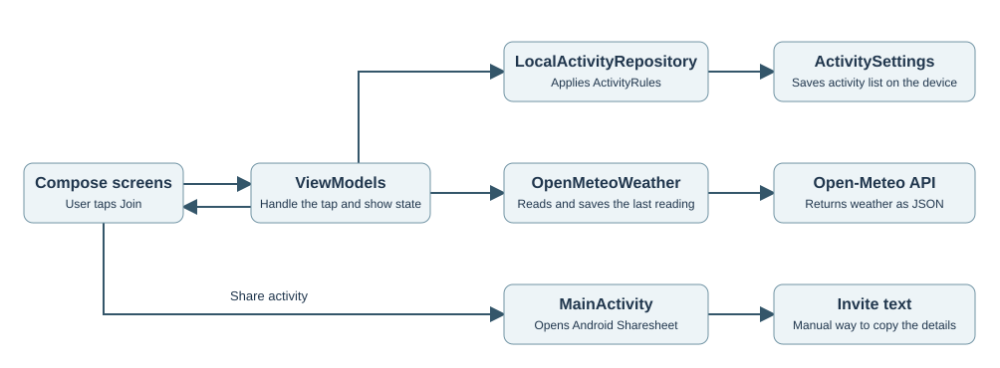

# JoinMe | M2 working MVP

**Team:** Nicolás Maqueda and Jaime Criado · **Platform:** Android

JoinMe helps adult international students in a residence find people for activities. The demo uses fictional accounts and activities seeded in Supabase.

## What to demonstrate

| Task | What to show |
|---|---|
| Discover and join | Sign in as `demo2@joinme.test`. Open Table Tennis and join. The count changes from 1 of 2 to 2 of 2, and the activity appears under Joined in My Activities. |
| Create an activity | Show an incomplete form, then choose a future start and complete the required fields. Show the preview, save, and find it under Created by you. |
| Restart and go offline | Force stop the app and reopen it with the same session. Turn off the connection and refresh. The app can still show the saved list and its last update. Changes need a connection. |
| Check the forecast | Open Football and use Check forecast. Open-Meteo returns the forecast for the hour the activity starts in Łódź. A failed refresh keeps a matching saved forecast visible. |
| Reminders and fallback | Allow notifications and join an activity that starts more than 30 minutes later. The app schedules a reminder for 30 minutes before the start. If notifications are off, My Activities still shows the details and explains how to enable reminders. |

## Architecture

[Editable Draw.io diagram](docs/m2/architecture.drawio)

Compose sends a Join tap to the ViewModel. The repository checks the rules and calls Supabase. The database checks the rules again and protects the last place. The repository saves the result in Room. StateFlow updates the screens from that local copy.

Supabase Auth handles the session. Room stores the activity list and the last update time. Draft forms and filters are interface state. WorkManager schedules local reminders. The weather request uses fixed city coordinates. It sends no user IDs or personal notes. Android can also share the activity details as plain text.

## Build, verification and next steps

Build and run `androidApp` with a configured Supabase project. See [setup](DEPLOY.md), the [demo checklist](docs/m2/demo.md) and the [AI review log](AI_USE.md). Submit the source commit or tag, this report and a configured build or agreed live demo access.

**Repository:** [JoinMe on GitHub](https://github.com/nicolasezequielmaqueda/JoinMe).

**Verified:** Android debug build and launch, 98 JVM tests and 2 Android tests. Local PostgreSQL checks covered the main database actions and two users trying to take the last place. The Open-Meteo request also worked from Windows.

1. Complete the full Android demo against the team's Supabase project, including restart, offline refresh, and reminders with permission on and off.
2. Repeat the large text and label checks on the updated screens.
3. Check reminder timing and clarify when the saved list may be out of date.
