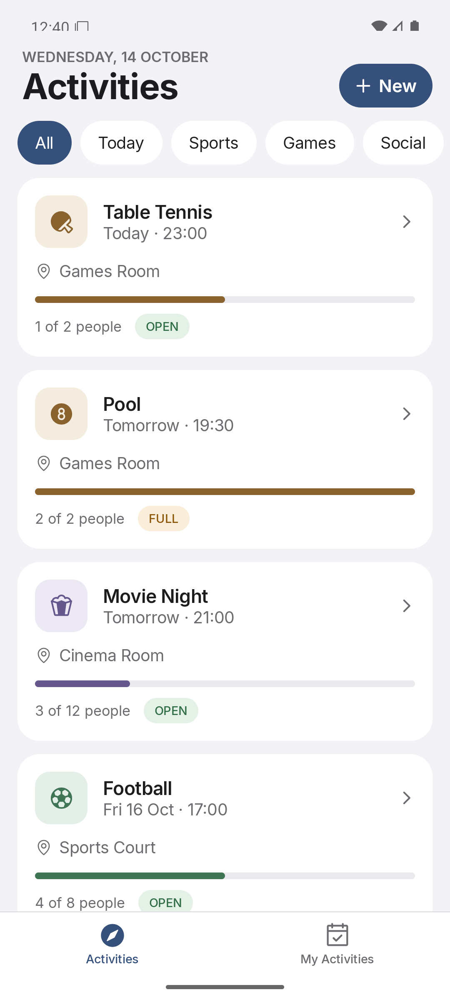
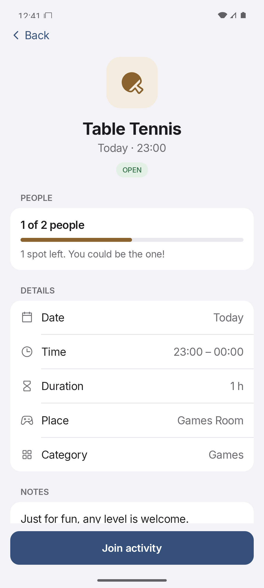
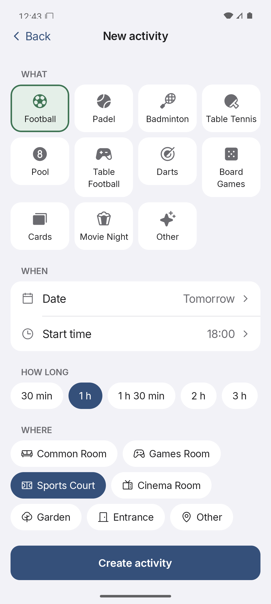
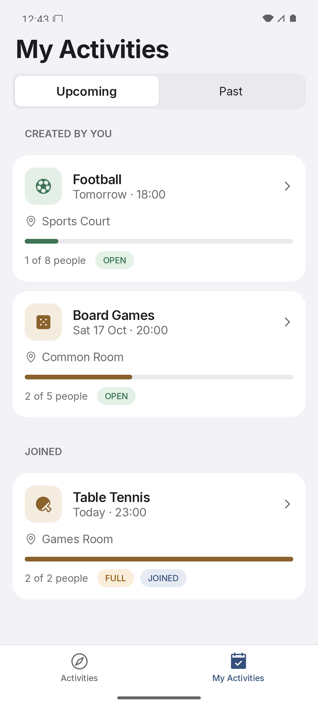

# JoinMe — M1 supporting notes

**Course:** Introduction to Mobile Systems — Mobile for Social Good

**Team:** Nicolás Maqueda and Jaime Criado. **Required platform:** Android. iOS is optional.

The team has confirmed instructor access and approval of Kotlin Multiplatform + Compose Multiplatform. [M1.md](../../M1.md) is the short submission document. These notes provide more detail.

**[E]** means evidence from a source or a reported observation. **[A]** means an assumption we still need to check.

## 1. Problem and idea

Our target users are adult Erasmus and international students living in a residence. They may have access to facilities but not know who wants to do the same activity at the same time.

Two everyday situations explain the idea:

- A new student goes to the games room after dinner and finds a free table tennis table. They may return to their room because they do not know who to ask and do not feel comfortable knocking on doors.
- Students who love football may know a few interested people but struggle to gather enough players. Word of mouth means asking around and finding a time that works for everyone.

JoinMe lets students post or join an activity with a time, place and number of people. A phone is useful because students can check the list while moving around the residence. Later, optional reminders can help them remember an activity.

## 2. Evidence and comparison

**[E]** Sawir et al. (2008), *Loneliness and International Students: An Australian Study*, reports loneliness and isolation among international students in Australia. [Source](https://doi.org/10.1177/1028315307299699). It gives background to our problem but does not prove that JoinMe will help our users.

**[E]** [WhatsApp groups](https://www.whatsapp.com/groups) already support messages, polls, events and attendance responses. A residence group can organise games without a separate activity app. JoinMe focuses on a list of activities with filters, available places and a participant limit.

**[A]** We think this focused list may make it easier to find a game. However, students may prefer to keep using their existing group. We have not shown that JoinMe is better.

Other assumptions are that students will open the app to find plans, feel more comfortable joining an activity than approaching strangers, and find the available activity types and shared places useful. We do not claim that JoinMe solves loneliness, improves mental health or guarantees friendships.

## 3. Scope and acceptance criteria

**US1 — Discover:** As an Erasmus student, I want to see activities so that I can find something to do with others.

- Cards show type, date/time, location, participant count and text status.
- All, Today, Sports, Games and Social filters show matching activities.
- If nothing matches, the app shows a clear message.

**US2 — Join:** As an Erasmus student, I want to join an activity without already knowing the other participants.

- Joining an OPEN activity adds the user once and increases the count by one.
- The button changes to Leave activity, and the activity appears under My Activities → Joined.
- The last place changes the status to FULL. Further joins are blocked.

**US3 — Create:** As an Erasmus student, I want to create an activity so that others can join me.

- The user chooses type, date, start time, duration, place and 2–30 participants. Notes are optional; Other needs a name.
- Missing fields or a start time that is not in the future prevent creation and show a message.
- The new activity appears in Activities and My Activities → Created by you, with its creator counted as `1/N`.

**Main task:** Activities → Table Tennis → Detail → Join → `1/2` becomes `2/2 FULL` → My Activities.

**Targets to measure:** find and join without help in under 60 seconds and at most five taps; create an activity in under two minutes. The informal review below did not measure these targets.

Chat, profiles, followers, photos, GPS/maps, payments, ratings, AI matching, complex login and tracking are outside scope. Activity editing and time-conflict warnings are also excluded. Android comes first; iOS is optional.

## 4. Prototype and peer review

The prototype uses Compose Multiplatform, real navigation and made-up data in memory. It has four screens: Activities, Activity Detail, Create Activity and My Activities. There is no database, network connection to a server or reminder system yet. A process restart resets all changes.

**[E] Peer review reported by the team:** We asked two classmates from another project team and class session: "You want to play table tennis. Find an activity with an available place, join it, and check where you can see the activity you have joined." Both completed it quickly, without help or observed difficulty. We kept the navigation because this check did not reveal a problem. No exact times or tap counts were recorded. Two classmates cannot represent all users.

The original notes also report an emulator check of join, leave, create, cancel and Upcoming/Past, plus a font check at 150%. These are previous notes, not new visual test results from the documentation review.

| Activities | Detail before joining | Create | My Activities |
|---|---|---|---|
|  |  |  |  |

These existing screenshots were recorded on a Pixel 8 emulator with Android 16. They show examples of the design; sample dates change when the app starts with a new repository.

## 5. Accessibility

| Requirement | What we know | Pending check |
|---|---|---|
| The main task must work at maximum system font size. | On 22 October 2026, the team reported that the app works well with the font at maximum size on the Medium Phone API 36.1 emulator. | Record the exact screens checked to make the result repeatable. |
| Status must be understandable without colour. | On 22 October 2026, the team confirmed on the Medium Phone API 36.1 emulator that OPEN, FULL, JOINED, CANCELLED and COMPLETED are visible and understandable from their text, and that the main actions have clear labels. | Passed in the team's manual check. A greyscale filter was not required. Repeat after relevant interface changes. |

Record the device, Android version, settings, result and problems. For CANCELLED, cancel Board Games and open My Activities → Past. See [DEPLOY.md](../../DEPLOY.md) for the steps.

We also aim for clear labels for screen readers and touch areas of at least 48 × 48 dp. These have not been fully checked. Visible text can label a button; decorative icons do not need a separate spoken description. TalkBack and size checks are still needed before claiming that all controls meet these goals.

## 6. Data, risks and later work

| Data planned for later versions | Purpose and storage | Risk or limit |
|---|---|---|
| Activity details and notes | Store in Supabase with a Room copy on the phone. | Notes could include personal information. Limit their length and show a warning. |
| Technical user ID and participation | Link a user to created/joined activities on the phone and server. | Even without names, these records can reveal activity patterns. Store only what is needed. |
| Notification permission | Device only, for optional reminders. | If denied, My Activities remains available. |

M1 uses made-up data and a fixed test user. We do not ask for names, photos, contact details, health data or GPS positions. Choosing a shared place reduces risk but does not guarantee safety. Spam prevention is outside the prototype scope.

Room is planned to keep data after a restart. Supabase is planned to share data. The app will show loading/errors and previously saved data offline, with a message explaining that it may be old. We still need to define offline join behaviour and server checks for ownership and the last available place.

Before the final delivery, we also need a manual test matrix, accessibility evidence, two voluntary sessions with consenting adult peers outside the team, an AI verification record and individual contribution notes. The earlier peer review does not replace these remaining requirements automatically.

## 7. Responsibilities and submission

| Member | Main responsibility |
|---|---|
| Nicolás and Jaime | Worked together on design, implementation, documentation and checks. |
| Both | Responsible for reviewing the main flow and preparing the demonstration. |

Both instructors have accepted repository access and the technology is approved, as confirmed by the team. Follow the deadline announced in WIKAMP.

After the final edits, commit and push the documents. Include the repository link and that exact commit ID in the submission. The previous commit `395c4b7ec86d1b327339890b0e7a64e602de9c23` does not include these documentation changes. Submit the short M1 brief with its images; keep these notes as support.
